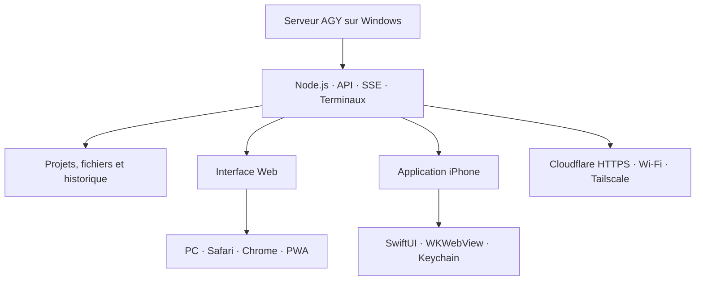

<div align="center">

# 🤖 AGY Console

### Ton espace de travail IA, accessible depuis le PC, le Web et l’iPhone.

Pilote AGY, discute avec tes projets, modifie tes fichiers, utilise le terminal
et gère Git depuis une seule interface moderne.

[](./package.json)
[](https://nodejs.org/)
[](https://github.com/NISMOR33/AGY/actions/workflows/build-ios.yml)
[](#-installation-sur-windows)

</div>

---

## ✨ Présentation

AGY Console transforme le serveur AGY installé sur ton PC en un véritable
studio de développement accessible partout : navigateur de bureau, téléphone,
tablette ou application iPhone.

Le serveur Node.js reste la source centrale. Tes projets, conversations,
fichiers et terminaux restent sur ton ordinateur. La version web et
l’application iOS peuvent être utilisées simultanément.

> [!IMPORTANT]
> AGY peut lire, modifier et exécuter des commandes dans les projets autorisés.
> Protège toujours l’accès distant avec un code secret robuste.

## 🚀 Fonctionnalités

### Chat AGY en temps réel

- réponses diffusées progressivement ;
- historique par projet et conversations multiples ;
- affichage des outils et fichiers utilisés ;
- commandes rapides et références `@fichier` ;
- arrêt immédiat d’une tâche ;
- statistiques de tokens par modèle ;
- notification sonore ou vibration en fin de tâche.

### Projets et fichiers

- création et ouverture de projets locaux ;
- clonage d’un dépôt Git ;
- explorateur de fichiers actualisé en direct ;
- lecture, modification, renommage et suppression ;
- création de dossiers ;
- import, téléchargement et export ZIP ;
- aperçu d’images et de pages HTML.

### Terminal intégré

- terminal PowerShell ou shell interactif ;
- terminal AGY séparé par projet ;
- plusieurs onglets simultanés ;
- redimensionnement automatique avec xterm.js.

### Git sans quitter AGY

- état du dépôt et diff ligne par ligne ;
- commit, push et pull ;
- création et changement de branche ;
- historique des derniers commits.

### Utilisation mobile

- interface responsive pour iPhone et Android ;
- navigation tactile adaptée ;
- dictée vocale et import de photos/fichiers ;
- accès local, Wi-Fi, Tailscale ou tunnel HTTPS Cloudflare ;
- application iOS native utilisant la console complète en `WKWebView` ;
- authentification iOS conservée dans le trousseau sécurisé Keychain.

## 🧭 Architecture



## 📋 Prérequis

- Windows 10 ou Windows 11 ;
- [Node.js](https://nodejs.org/) 20 ou plus récent ;
- Git ;
- AGY installé et disponible avec la commande `agy` ;
- une connexion Internet pour le tunnel Cloudflare et les dépendances ;
- facultatif : un iPhone et [Sideloadly](https://sideloadly.io/) pour l’app iOS.

## 🖥️ Installation sur Windows

### Méthode simple

1. Télécharge ou clone le dépôt :

   ```powershell
   git clone https://github.com/NISMOR33/AGY.git
   cd AGY
   ```

2. Double-clique sur `Lancer-agy-console.bat`.

Le lanceur installe les dépendances manquantes, démarre le serveur et affiche
les adresses disponibles.

### Méthode PowerShell

```powershell
npm install
npm start
```

Ouvre ensuite :

```text
http://localhost:3000
```

### Mode local uniquement

Pour désactiver le tunnel Internet :

```powershell
npm run local
```

## 🌍 Accès depuis l’extérieur

Au démarrage normal, AGY peut créer automatiquement un tunnel HTTPS. L’adresse
publique ressemble à ceci :

```text
https://exemple-aleatoire.trycloudflare.com
```

Cette adresse permet de rejoindre la console en 4G/5G sans ouvrir de port sur
la box Internet.

> [!WARNING]
> Une adresse `trycloudflare.com` temporaire peut changer après un redémarrage.
> Ne partage jamais l’URL avec son code d’accès dans un espace public.

## 🍎 Application iPhone

L’app iOS est un conteneur natif de la console. Elle conserve toutes les
fonctions web et se connecte au même serveur Windows.

### Compiler l’IPA avec GitHub

1. Ouvre [GitHub Actions](https://github.com/NISMOR33/AGY/actions).
2. Sélectionne **Build AGY iOS (.ipa)**.
3. Lance le workflow sur la branche `main`, ou pousse une modification iOS.
4. Télécharge l’artifact nommé `agy-ios-ipa-build-XX`.
5. Décompresse l’archive pour obtenir `agy-island.ipa`.

Chaque compilation reçoit un numéro de build unique pour éviter que l’iPhone
réinstalle une ancienne version en cache.

### Installer avec Sideloadly

1. Installe [Sideloadly](https://sideloadly.io/) sur Windows.
2. Branche l’iPhone par USB et accepte **Faire confiance à cet ordinateur**.
3. Glisse le fichier IPA dans Sideloadly.
4. Saisis l’identifiant Apple demandé, puis clique sur **Start**.
5. Sur l’iPhone, autorise le profil si iOS le demande.
6. Ouvre AGY et saisis l’URL HTTPS du serveur ainsi que le code d’accès.

> [!NOTE]
> Avec un compte Apple gratuit, la signature Sideloadly doit généralement être
> renouvelée tous les sept jours. L’application n’intègre volontairement plus
> de Dynamic Island ou de Live Activity.

## ⚙️ Configuration

AGY conserve sa configuration dans le dossier utilisateur `.agy-console`.
Les principales options peuvent être définies avant le lancement :

| Option | Valeur par défaut | Utilité |
|---|---:|---|
| `PORT` | `3000` | Port du serveur web |
| `AGY_ROOT` | `~/agy-projects` | Dossier principal des projets |
| `AGY_CMD` | `agy` | Commande utilisée pour lancer AGY |
| `AGY_ARGS` | vide | Arguments supplémentaires transmis à AGY |
| `AGY_PIN` | configuré localement | Code d’accès à la console |
| `AGY_TOKEN` | généré | Jeton interne persistant |
| `AGY_TUNNEL` | `1` | Mettre à `0` pour couper le tunnel |
| `AGY_TUNNEL_TOKEN` | vide | Jeton d’un tunnel Cloudflare personnalisé |

Exemple PowerShell pour un lancement local sur un autre port :

```powershell
$env:PORT = "3100"
$env:AGY_TUNNEL = "0"
npm start
```

Pour générer un nouveau jeton interne :

```powershell
npm run new-token
```

## 🔄 Mettre AGY à jour

Avant une mise à jour, arrête proprement le serveur et sauvegarde les fichiers
de configuration locaux.

```powershell
git status
git pull --ff-only origin main
npm install
npm start
```

Évite `git reset --hard` et les force-push : ils peuvent supprimer des
modifications locales ou réécrire l’historique du dépôt.

## 🔐 Sécurité

- utilise un code d’accès long et unique ;
- ne publie jamais `.env`, tokens, cookies ou sauvegardes ;
- garde les projets sensibles hors des dossiers partagés inutilement ;
- préfère le mode local quand l’accès Internet n’est pas nécessaire ;
- vérifie les commandes proposées avant d’autoriser une action sensible ;
- renouvelle le code si une URL ou une capture l’a exposé.

Les secrets, historiques et paramètres locaux ne doivent pas être ajoutés au
dépôt Git.

## 🧰 Dépannage

### La page ne s’ouvre pas

Vérifie que le serveur fonctionne :

```powershell
Invoke-RestMethod http://localhost:3000/api/ping
```

Une réponse contenant `"ok": 1` confirme que le serveur répond.

### Le tunnel Cloudflare ne fonctionne plus

- redémarre AGY pour obtenir une nouvelle URL temporaire ;
- vérifie le pare-feu et la connexion Internet ;
- utilise temporairement `http://ADRESSE-IP-DU-PC:3000` sur le même Wi-Fi.

### L’app iPhone affiche une ancienne interface

1. vérifie que le serveur Windows utilise le dernier commit ;
2. redémarre le serveur après `git pull` ;
3. supprime l’ancienne app iPhone ;
4. installe l’artifact portant le numéro de build le plus élevé.

### L’app ne se connecte pas

- utilise l’adresse HTTPS complète, sans espace ;
- vérifie le code d’accès ;
- teste d’abord l’URL dans Safari ;
- confirme que `/api/ping` répond depuis le réseau utilisé.

### Le terminal ne démarre pas

Vérifie que les dépendances natives sont correctement installées :

```powershell
npm install
```

Puis confirme que PowerShell et la commande `agy` sont disponibles dans le
terminal Windows utilisé pour lancer le serveur.

## 🗂️ Structure du projet

```text
AGY/
├── public/                 Interface web et service worker
├── ios-island/             Application iOS SwiftUI/WKWebView
├── .github/workflows/      Compilation automatique de l’IPA
├── server.js               API, SSE, fichiers, terminaux et tunnel
├── supervisor.js           Supervision du serveur
├── launch-service.js       Lancement en service
├── Lancer-agy-console.bat  Lanceur Windows rapide
└── package.json            Scripts et dépendances Node.js
```

## 🛣️ Améliorations envisagées

- interface mobile encore plus compacte ;
- journal chronologique des fichiers et commandes utilisés ;
- notifications de fin de tâche plus robustes ;
- gestion native des imports et téléchargements iOS ;
- reconnexion automatique et gestion de plusieurs serveurs ;
- amélioration progressive des écrans SwiftUI sans casser la version web.

## 🤝 Contribuer

1. crée une branche dédiée ;
2. effectue une modification ciblée ;
3. teste la version web et, si nécessaire, le workflow iOS ;
4. ouvre une Pull Request avec une description claire et des captures.

---

<div align="center">

**AGY Console — un seul serveur, tous tes projets, partout.**

[Signaler un problème](https://github.com/NISMOR33/AGY/issues) ·
[Voir les compilations iOS](https://github.com/NISMOR33/AGY/actions)

</div>
